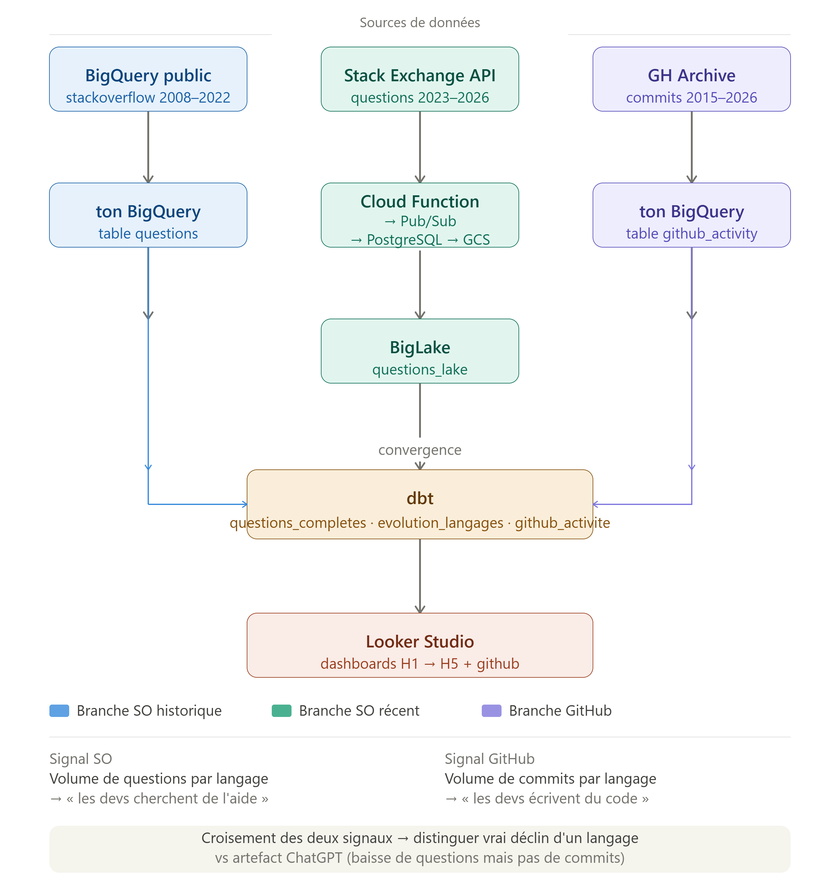

# Stack Overflow Pipeline

## Évolution des langages de programmation (2008 → 2026)

Pipeline data engineering complet sur GCP qui analyse l'évolution des langages de programmation sur Stack Overflow depuis 2008.

**Principale découverte :** depuis ChatGPT (nov. 2022), le volume de questions chute, ce qui rend Stack Overflow peu fiable pour mesurer l'usage réel des langages. Les données sont saines, mais elles doivent être lues dans leur contexte.

## Architecture

## Architecture

## Stack technique

| Couche | Outil | Pourquoi |
|---|---|---|
| Infrastructure | Terraform | Toute l'infra GCP est décrite en code, versionnée et reproductible |
| CI/CD | Cloud Build | `terraform plan` automatique à chaque push, déploiement soumis à approbation manuelle |
| Ingestion | Cloud Function + Pub/Sub | Serverless, et le découplage évite de perdre des données si le destinataire est indisponible |
| Secrets | Secret Manager | Aucune clé API dans le code |
| Landing zone | PostgreSQL (Docker) | Contraintes SQL qui garantissent la qualité avant l'analytique |
| Orchestration | Airflow (Docker) | Dépendances entre tâches, retry automatique, observabilité |
| Data lake | GCS (Parquet partitionné par mois) + BigLake | BigQuery interroge les fichiers du lac sans déplacer les données, et le partitionnement évite de tout scanner |
| Data warehouse | BigQuery | Requêtes analytiques rapides sur des millions de lignes |
| Transformation | dbt | Transformations SQL versionnées, testées et documentées |
| Visualisation | Looker Studio | Dashboards connectés directement à BigQuery |

## Résultats

| Hypothèse | Verdict | Observation |
|---|---|---|
| H1 : cycles de mode | Non concluant | Flash, ActionScript et Prolog déclinent rapidement avant 2022, mais les cycles montée/descente ne sont pas assez nets pour parler d'effet de mode |
| H2 : disparition de langages | Non validée | Aucun des 58 langages étudiés n'a atteint zéro question par mois avant 2022 |
| H3 : l'IA favorise certains langages | Non concluant | Stack Overflow ne reflète plus l'usage réel après 2022, test impossible avec cette seule source |
| H4 : sorties de modèles IA | Non concluant | Un déclin de Python apparaît dès octobre 2022, avant ChatGPT : effet saisonnier ou arrivée de GitHub Copilot, non tranché |
| H5 : l'IA change le volume de questions | Validée (baisse) | Le volume de questions diminue nettement depuis ChatGPT |

> Corrélation observée, causalité non prouvée : les dates de sortie des modèles coïncident avec les baisses, sans pouvoir démontrer un lien de cause à effet.

## Structure du repo

```
├── airflow/              # DAG d'orchestration quotidienne + Docker
├── cloud_functions/      # Fonction d'ingestion (API Stack Exchange → Pub/Sub) + tests pytest
├── dbt/                  # Modèles de transformation SQL sur BigQuery
├── scripts/              # Bootstrap API 2023-2026 + export PostgreSQL → GCS (Parquet)
├── terraform/            # Infrastructure GCP déployée automatiquement par le CD
├── terraform-manuel/     # Ressources IAM, appliquées à la main
├── cloudbuild.yaml       # CI : validation à chaque push
└── cloudbuild-cd.yaml    # CD : déploiement Terraform avec approbation manuelle
```

**Pourquoi deux dossiers Terraform ?** Les permissions IAM sont sensibles : une erreur peut donner trop de droits. Elles sont donc isolées dans `terraform-manuel/` (avec son propre état Terraform), hors du périmètre du déploiement automatique.